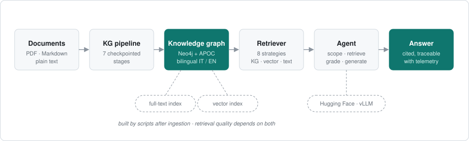

<div align="center">

# Circular Food GraphRAG

**Grounded question answering over a knowledge graph, built from documents and measured against a frozen reference set.**

[](https://github.com/FrancescoLazzarotto/circular-food-graphrag/actions/workflows/ci.yml)
[](https://www.python.org/)
[](LICENSE)

</div>

<br>

<p align="center">
  
</p>

## Overview

The repository covers the whole path from a folder of PDFs to a scored table:
a checkpointed pipeline that extracts and resolves entities into a Neo4j graph,
eight retrieval strategies over that graph, a LangGraph agent that answers with
numbered citations, and an evaluation toolkit that scores the result.

It is applied to a bilingual Italian/English corpus on the circular economy of
food.

- **Grounded.** Every answer cites document and page. A citation gate checks each tag against the evidence the reader can see, and a quote gate checks each quoted passage against the retrieved text.
- **Comparable.** The strategies range from an LLM-only baseline to multi-hop subgraph expansion. Each run writes its fully resolved configuration next to its output.
- **Bilingual.** A lexical channel handles in-language lookup and a multilingual vector channel crosses the Italian/English gap.

## Quick start

You need Neo4j 5 with APOC, an OpenAI-compatible generation server, and a
multilingual encoder. [Installation](docs/installation.md) covers all three.

```bash
conda create -n graphllm python=3.12 -y && conda activate graphllm
pip install -e .
cp .env.example .env
```

Check the setup, then ask a question:

```bash
python scripts/smoke/smoke_check.py

graphrag-demo --llm --vllm --strategies hybrid --cite-evidence \
  --question "What are the three C's of the Circular Economy for Food framework?"
```

> [!IMPORTANT]
> The repository ships no corpus and no graph. Supply your own PDF or Markdown
> documents and build the graph first: see the
> [Knowledge Graph pipeline](docs/kg_pipeline.md).

| Command | Purpose |
|---|---|
| `graphrag-demo` | Questions and experiment campaigns |
| `graphrag-kg` | Knowledge graph construction |
| `graphrag-eval` | Metrics, LLM judge and gold scoring |

Campaigns, scoring and the reference runs are described in
[Experiments](docs/experiments.md).

## Documentation

**Getting started**

- [Installation](docs/installation.md): prerequisites, extras, pinned environments
- [Knowledge Graph pipeline](docs/kg_pipeline.md): stages, corpus registry, indexes, adding documents
- [Retrieval](docs/retrieval.md): the per-query flow and the eight strategies

**Reference**

- [CLI](docs/cli.md): every `graphrag.cli` option and its default
- [Configuration](docs/configuration.md): every environment variable
- [Repository structure](docs/repository_structure.md)
- [Evaluation](evaluation/README.md): gold sets, scorer, judge

**Operations**

- [Experiments](docs/experiments.md): runners, campaigns, output layout
- [Graph hosting](docs/graph_hosting.md): the local production graph, backups, health checks
- [Cluster](docs/cluster.md): SLURM templates
- [Troubleshooting](docs/troubleshooting.md)
- [Commands](COMMANDS.md): task recipes

**Quality**

- [Testing](docs/testing.md): the suite and the three CI jobs
- [Known limitations](docs/limitations.md)
- [Reproducibility](docs/reproducibility.md): what changed between runs, and what that does to comparisons

Contributors and coding agents: see [AGENTS.md](AGENTS.md).

## Known limitations

This is a research codebase, and results should be read with its limits in mind:

- Edge provenance is single-valued: a triple attested in several documents keeps the source of the last ingestion (0.8% of edges are affected).
- Runs produced before 2026-08-17 are not directly comparable with later ones.
- APOC is a hard dependency: there is no fallback projection without it.

The full list, each with the measurement behind it, is in
[docs/limitations.md](docs/limitations.md) and
[docs/reproducibility.md](docs/reproducibility.md).

## Citation

If you use this software, cite it via [`CITATION.cff`](CITATION.cff).

## License

Released under the [MIT License](LICENSE).
